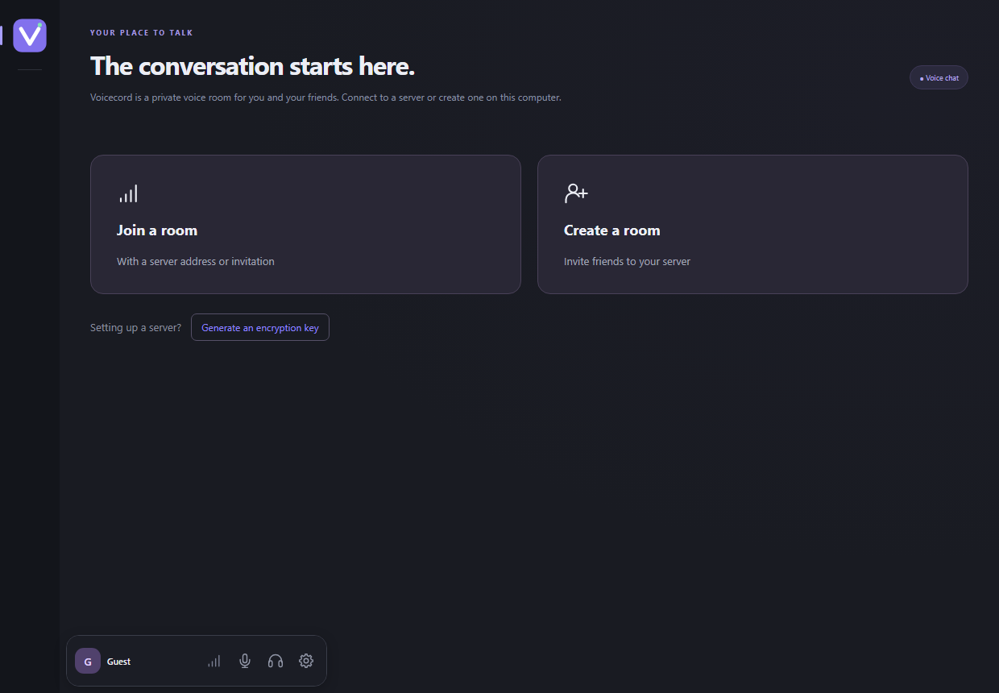

# Voicecord — self-hosted voice chat for gaming and friends

[Русский](README.ru.md) · English

Voicecord is an **alternative to Discord and TeamSpeak for voice chat** on Windows. Get friends together before a match, talk to your team while you play, or give your community a room it can come back to. Join with an invitation and a nickname. No account required.

**[Download Voicecord 0.3.0 for Windows 10/11 (x64)](https://github.com/IlyaRusskikh/voicecord/releases/download/v0.3.0/Voicecord.Setup.0.3.0.exe)** · [Get started](#get-started) · [Self-hosting guide (Russian)](docs/SERVER.md)



## What you can do with Voicecord

- **Get friends together for a game night.** Start a room on your PC and send an invitation. The room stays available while Voicecord runs, including in the system tray.
- **Talk on your local network.** Share a LAN invitation when everyone is on the same network, whether you're at a LAN party or playing at home.
- **Give your team a permanent room.** Run a server on Linux and keep using the same address. Friends can talk while your gaming PC is off.

## Familiar voice controls, your own server

Voicecord takes inspiration from **Discord** for easy-to-join voice rooms and individual volume controls, and from **TeamSpeak** for hosting your own server and deciding who can join. It brings these ideas together in an open-source app with invitation-based access.

- **Set up audio the way you like it.** Choose your microphone and headphones, listen to a mic test, and adjust each person's volume separately.
- **Talk when you speak or hold a key.** Choose voice activation or Push-to-Talk. Use global shortcuts for microphone mute and incoming audio while your game is open.
- **Manage your call.** Use the controls above the chat divider to mute, switch audio devices, or leave. Hover over an avatar to reveal the participant’s name and signal icon. Rest the pointer on the icon to see their server ping and incoming audio packet loss.
- **Set a profile picture.** Under **Settings → About me**, choose a PNG, JPEG, or WebP, then zoom and position the crop. Participants see your current nickname and avatar in the room and in retained chat history.
- **Make speech easier to hear.** RNNoise reduces background noise on your PC, echo cancellation reduces echo, and automatic gain control evens out the level of your voice.
- **Return to your favorite rooms.** Bookmark a server so you can find it again quickly.
- **Send messages during a call.** The room opens with chat below the participant cards. Press Enter to send or Shift+Enter for a new line. You can send up to three messages per second and see when someone else is typing. Drag the divider to resize either section. Hover over **Features** to see how the room handles encryption and history. Built-in E2EE rooms keep history in memory until the server stops. Standalone servers configured with E2EE and a key fingerprint keep encrypted history for up to seven days.

<details>
<summary>See audio settings and room creation</summary>


</details>

## Get started

1. **Install Voicecord.** [Download the installer](https://github.com/IlyaRusskikh/voicecord/releases/download/v0.3.0/Voicecord.Setup.0.3.0.exe) on each Windows PC. Choose English or Russian.
2. **Pick a nickname.** Open **Settings → About me** and enter a nickname. You can test your microphone under **Voice**.
3. **Get your friends together.** Select **Create a room**, give the room a name, and choose a password of at least 8 characters. Share the full invitation privately. Your friend opens **Join a room** and pastes the link.

Already have an invitation? Open **Join a room** after installing. [First call on two PCs (Russian)](docs/FIRST-CALL.ru.md).

## Questions and setup

<details>
<summary>How do I invite someone on a different network?</summary>

In the room creation dialog, choose **Check** next to **Can I host over the internet?**. Internet hosting uses incoming TCP 18443, TCP 18444, and UDP 18445 by default. If your router or ISP restricts inbound connections, you can host on a Linux VPS with a public IP. The port check uses an external service. [How the check works (Russian)](docs/SELFHOST-CHECK.md) · [Linux server setup (Russian)](docs/SERVER.md).

</details>

<details>
<summary>Which devices can run Voicecord?</summary>

The desktop client runs on Windows 10/11 x64. You can deploy the persistent server with Docker Compose on Linux amd64 or arm64. Voice travels through a LiveKit media server over WebRTC. [Server guide (Russian)](docs/SERVER.md).

</details>

<details>
<summary>Can I enable end-to-end encryption?</summary>

You can enable experimental E2EE when creating a room. With E2EE off, voice is encrypted in transit and the media server can access the audio. A built-in room invitation carries the password and, with E2EE enabled, the encryption key. Share it privately. [E2EE security model and setup](docs/E2EE.md).

</details>

<details>
<summary>How do I update or get help?</summary>

Starting with 0.2.0, Voicecord offers new releases at startup. The installer download is verified and your profile is preserved. If you're on 0.1.0, update manually once. [How updates work](docs/UPDATES.md).

For setup or connection issues, see the [troubleshooting guide (Russian)](docs/GUIDE.ru.md). Ask questions or suggest changes in [GitHub Issues](https://github.com/IlyaRusskikh/voicecord/issues/new/choose). Include your version and steps to reproduce the issue. Remove live invitations, passwords, keys, and personal network details.

</details>

## For developers

<details>
<summary>Build and run checks on Windows x64</summary>

Install Node.js **24.22.1+** with npm, Go **1.27.3+**, Python **3.13**, and Visual Studio Build Tools with **Desktop development with C++** and a Windows SDK. You can set the Go executable with `VOICECORD_GO`.

```powershell
npm ci
npm run native:build
npm run dev
```

Run `.\build.cmd -InstallDependencies` to build a Windows installer. The first development launch builds the bundled API and downloads LiveKit with checksum verification. [Build guide (Russian)](docs/GUIDE.ru.md).

Use `npm run build`, `npm test`, `npm run smoke`, and `npm run check:public` when changing the client. Run `go test ./...` and `go vet ./...` in `server` for server changes. [GitHub Actions](https://github.com/IlyaRusskikh/voicecord/actions/workflows/check.yml).

</details>

[Contributing](CONTRIBUTING.md) · [API](docs/API.md) · [Release process](docs/RELEASING.md)

Voicecord is licensed under [GNU AGPL-3.0-only](LICENSE). Third-party components retain their own licenses. [Third-party notices](THIRD_PARTY_NOTICES.md).

## Project status

**0.3.0 is a public pre-release.** It adds participant counts and drag-to-reorder bookmarks, quick audio device selection, and tray startup. Counts on a VPS require server 0.3.0. Corresponding source and SHA-256 are available in the [v0.3.0 release](https://github.com/IlyaRusskikh/voicecord/releases/tag/v0.3.0). [Changelog](CHANGELOG.md).
