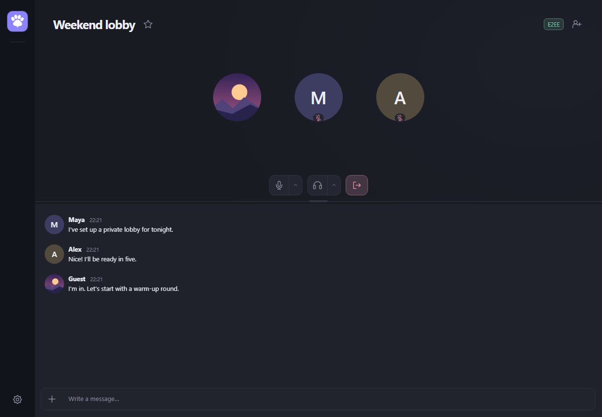
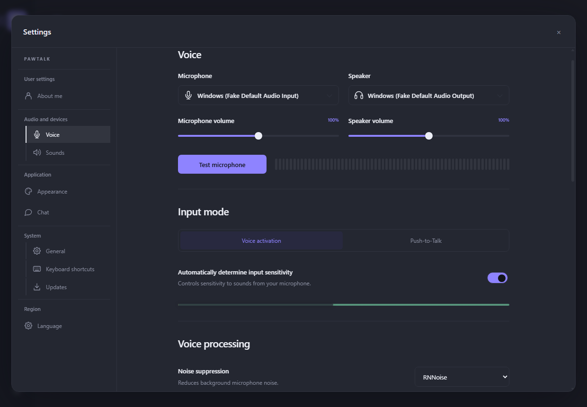
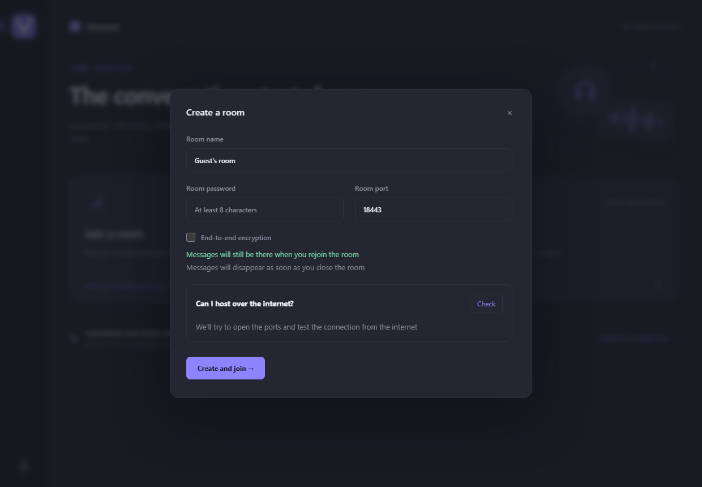

# PawTalk — self-hosted voice chat for gaming and friends

[Русский](README.ru.md) · English

Development: Client **0.8.1** prepares the automatic transition from legacy `v*` to `client-v*` releases. It has not been published; the download below remains the public 0.8.0 release. VPS Server versions are independent.

[](https://github.com/IlyaRusskikh/PawTalk/actions/workflows/check.yml)

PawTalk is an **alternative to Discord and TeamSpeak for voice chat** on Windows. Get friends together before a match, talk to your team while you play, or give your community a room it can come back to. Join with an invitation and a nickname. No account required.

**[Download PawTalk 0.8.0 for Windows 10/11 (x64)](https://github.com/IlyaRusskikh/pawtalk/releases/download/v0.8.0/PawTalk.Setup.0.8.0.exe)** · [Get started](#get-started) · [Linux server (Russian)](docs/SERVER.md) · [Persistent server on Windows (Russian)](docs/SERVER-WINDOWS.md)



## What you can do with PawTalk

- **Get friends together for a game night.** Start a room on your PC and send an invitation. The room stays available while PawTalk runs, including in the system tray.
- **Talk on your local network.** Share a LAN invitation when everyone is on the same network, whether you're at a LAN party or playing at home.
- **Give your team a permanent room.** Run a server on a Linux VPS or an always-on Windows PC using Docker Swarm in a Linux VM. The room runs independently of the PawTalk app; with a VPS, friends can also talk while your home PC is off. [Windows guide (Russian)](docs/SERVER-WINDOWS.md).

## Feature comparison

| Feature | PawTalk | Discord | TeamSpeak |
| --- | :---: | :---: | :---: |
| Advanced noise suppression | ✅ | ✅ | ❌ |
| Suppression of a nearby participant's voice | ✅ | ❌ | ❌ |
| Modern interface | ✅ | ✅ | ❌ |
| Host the server on your own hardware | ✅ | ❌ | ✅ |
| Open-source client and server | ✅ | ❌ | ❌ |

## Familiar voice controls, your own server

PawTalk takes inspiration from **Discord** for easy-to-join voice rooms and individual volume controls, and from **TeamSpeak** for hosting your own server and deciding who can join. It brings these ideas together in an open-source app with invitation-based access.

- **Set up audio the way you like it.** Choose your microphone and headphones, listen to a mic test, and adjust each person's volume separately.
- **Talk when you speak or hold a key.** Choose voice activation or Push-to-Talk. Use global shortcuts for microphone mute and incoming audio while your game is open.
- **Manage your call.** Use the controls above the chat divider to mute, switch audio devices, or leave. Hover over an avatar to reveal the participant’s name and signal icon. Hover over the signal icon to see the current ping. Click it to open a connection summary with outgoing audio packet loss to the LiveKit server, reported by the receiver through RTCP; clicking outside closes it. On your own card, choose Debug to view Transport and Outbound statistics with two-minute charts. History stays on your device and resets when you leave the room.
- **Set a profile picture.** Under **Settings → About me**, choose a PNG, JPEG, or WebP. Zoom and position the image in the circular preview. Participants see your current nickname and avatar in the room and in retained chat history.
- **Make speech easier to hear.** RNNoise reduces background noise on your PC, echo cancellation reduces echo, and automatic gain control evens out the level of your voice.
- **Return to your favorite rooms.** Bookmark a server so you can find it again quickly. Your current unsaved voice room appears in the sidebar with a stopwatch badge; hover over it and click the star to save the room. Reply previews preserve message formatting.
- **Send messages during a call.** The room opens with chat below the participant cards. Press Enter to send or Shift+Enter for a new line. You can send up to three messages per second and see when someone else is typing. Drag the divider to resize either section. Built-in E2EE rooms keep history in memory until the server stops. VPS history uses a configurable storage budget with no age limit (see Project status).
- **Hear the room.** All notification recordings use CC0. Cat meows mark joining and leaving. Five soft purr variations announce new messages in the current room when the app is inactive or the chat is scrolled up. Your own messages and loaded history stay silent. Sounds use your selected output device and volume; disable them under **Settings → Audio and devices → Sounds**.

<details>
<summary>See audio settings and room creation</summary>





</details>

## Get started

1. **Install PawTalk.** [Download the installer](https://github.com/IlyaRusskikh/pawtalk/releases/download/v0.8.0/PawTalk.Setup.0.8.0.exe) on each Windows PC. Choose English or Russian.
2. **Pick a nickname.** Open **Settings → About me** and enter a nickname. You can test your microphone under **Voice**.
3. **Get your friends together.** Select **Create a room**, give the room a name, and choose a password of at least 8 characters. Share the full invitation privately. Your friend opens **Join a room** and pastes the link.

Already have an invitation? Open **Join a room** after installing. [First call on two PCs (Russian)](docs/FIRST-CALL.ru.md).

## Questions and setup

<details>
<summary>How do I invite a friend?</summary>

In the room creation dialog, choose **Check** next to **Can I host over the internet?**. Internet hosting uses incoming TCP 18443, TCP 18444, and UDP 18445 by default. If your router or ISP restricts inbound connections, you can host on a Linux VPS with a public IP. For a persistent server on your home Windows PC, use [Docker Swarm in a Linux VM (Russian)](docs/SERVER-WINDOWS.md); internet access also requires a public IP and port forwarding.
To check whether you can self-host, copy this command into **Windows PowerShell**:

```powershell
$code = (Invoke-WebRequest -UseBasicParsing 'https://raw.githubusercontent.com/IlyaRusskikh/pawtalk/main/scripts/check-selfhost.ps1').Content; & ([ScriptBlock]::Create($code))
```

[How the check works (Russian)](docs/SELFHOST-CHECK.md) · [Linux server setup (Russian)](docs/SERVER.md).

</details>

<details>
<summary>Which devices can run PawTalk?</summary>

The desktop client runs on Windows 10/11 x64. You can deploy the persistent server with Docker Swarm on Linux amd64 or arm64, including a [Linux VM on an always-on Windows PC (Russian)](docs/SERVER-WINDOWS.md). Voice travels through a LiveKit media server over WebRTC. [Server guide (Russian)](docs/SERVER.md).

</details>

<details>
<summary>Is PawTalk safe to use?</summary>

PawTalk protects the connection to the server with TLS and checks the certificate fingerprint from the invitation. Voice is encrypted in transit over WebRTC. However, **without E2EE, the server operator can access voice and stored chat**: choose a server you trust.

You can enable **experimental end-to-end encryption (E2EE)** for voice and chat. It is off by default; participants receive the shared key through the invitation. The server can still see IP addresses, the participant list, and traffic timing and volume. Automatic key rotation and forward secrecy are not available yet. A built-in room invitation contains the password and, with E2EE enabled, the secret key: share it privately and do not publish it.

PawTalk is still a public preview. Updates are verified using a signed manifest and SHA-256, but the Windows installer is not yet Authenticode-signed. [E2EE security model and setup](docs/E2EE.md) · [Security policy and vulnerability reporting](SECURITY.md).

</details>

<details>
<summary>How do I update or get help?</summary>

Current PawTalk builds check GitHub releases at startup and verify the update manifest signature and the file's SHA-256 checksum before installing. If GitHub is unavailable, the updater can use a compatible bookmarked room as a download relay. Both built-in Windows self-host rooms and VPS rooms support this; the room must be running and able to reach GitHub for metadata and uncached files. The server streams and caches one installer on disk, serves repeat downloads without fetching the installer from GitHub again, and removes the older cached installer after a newer version finishes downloading. Installer transfers have no server bandwidth cap.

[Update details](docs/UPDATES.md).
For setup or connection issues, see the [troubleshooting guide (Russian)](docs/GUIDE.ru.md). Ask questions or suggest changes in [GitHub Issues](https://github.com/IlyaRusskikh/pawtalk/issues/new/choose). Include your version and steps to reproduce the issue. Remove live invitations, passwords, keys, and personal network details.

</details>

## For developers

<details>
<summary>Build and run checks on Windows x64</summary>

Install Node.js **24.22.1+** with npm, Go **1.27.3+**, Python **3.13**, and Visual Studio Build Tools with **Desktop development with C++** and a Windows SDK. You can set the Go executable with `PAWTALK_GO`.

```powershell
npm ci
npm run native:build
npm run dev
```

Run `.\build.cmd -InstallDependencies` to build a Windows installer. The first development launch builds the bundled API and downloads LiveKit with checksum verification. [Build guide (Russian)](docs/GUIDE.ru.md).

Use `npm run build`, `npm test`, `npm run smoke`, and `npm run check:public` when changing the client. Run `go test ./...` and `go vet ./...` in `server` for server changes. [GitHub Actions](https://github.com/IlyaRusskikh/pawtalk/actions/workflows/check.yml).

</details>

[Documentation index](docs/README.md) · [Development and local Docker](docs/DEVELOPMENT.md) · [Architecture](docs/ARCHITECTURE.md) · [Contributing](CONTRIBUTING.md) · [API](docs/API.md) · [Release process](docs/RELEASING.md)

PawTalk is licensed under [GNU AGPL-3.0-only](LICENSE). Third-party components retain their own licenses. [Third-party notices](THIRD_PARTY_NOTICES.md).

A [field-by-field server .env guide](docs/SERVER.md#разбор-env-что-и-как-заполнять) covers allowed values, storage budgets, Swarm updates and applying changes.

## Project status

**Current public preview: [PawTalk 0.8.0](https://github.com/IlyaRusskikh/PawTalk/releases/tag/v0.8.0)** — Windows 10/11 x64 client and self-hosted Linux amd64/arm64 server, including a Linux VM on an always-on Windows PC. This is not a stable release.

### Available in 0.8.0

- Voice rooms with invitations, nickname-only entry, Push-to-Talk, per-user volume, RNNoise noise suppression and audio device selection.
- Text chat with replies, Markdown, editing/deleting your own messages on updated servers, typing indicators, room previews, unread counts and static PNG/JPEG/WebP attachments up to 2 MiB.
- Profiles and avatars, bookmarked rooms, light/dark/custom themes and Russian/English interfaces.
- Notification sounds for joining, leaving and messages; adjustable shared notification volume and previews.
- Optional experimental E2EE for voice and chat; the secret key is shared with participants via the invitation. [Security model](docs/E2EE.md).
- Host a temporary room in the Windows app or a persistent room via Docker Swarm on Linux, including a [Linux VM on Windows (Russian)](docs/SERVER-WINDOWS.md); persistent chat storage defaults to 128 MiB and evicts the oldest content when full. [Server guide](docs/SERVER.md).
- Update checks and downloads with signed manifests, SHA-256 verification and fallback relays through compatible bookmarked rooms. [Update details](docs/UPDATES.md).

### Important limitations

- The Windows installer is **not Authenticode-signed**. Release assets include SHA-256 checksums; they do not replace an OS publisher signature.
- Hardware acceptance remains outstanding for real microphones, games/global PTT and UAC, external-network calls, packet loss, and large groups. Automated tests use synthetic devices where indicated. [Acceptance checklist](docs/ACCEPTANCE.md) · [Verification history](docs/VERIFICATION.md).
- E2EE is **off by default and experimental**. Without it the media server can access voice, and the server can read stored chat content. E2EE currently has no automatic key rotation or forward secrecy. Share complete invitations privately. [Details](docs/E2EE.md).
See the [changelog](CHANGELOG.md) for previous versions, [settings reference](docs/SETTINGS.md) for all controls, and [security policy](SECURITY.md) for reporting vulnerabilities.
