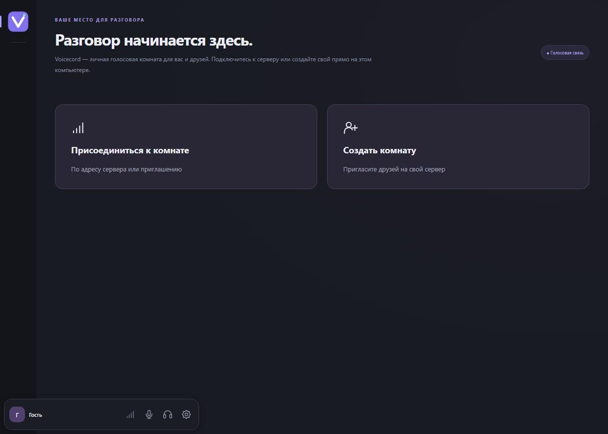

# Voicecord — голосовой чат для игр и друзей на своём сервере

Русский · [English](README.md)

Voicecord — **альтернатива Discord и TeamSpeak для голосового общения** на Windows. Соберите друзей перед матчем, общайтесь с командой во время игры или заведите постоянную голосовую комнату для своего сообщества. Чтобы присоединиться, достаточно приглашения и никнейма. Регистрация не нужна.

**[Скачать Voicecord 0.3.0 для Windows 10/11 (x64)](https://github.com/IlyaRusskikh/voicecord/releases/download/v0.3.0/Voicecord.Setup.0.3.0.exe)** · [Как начать](#как-начать) · [Инструкция для своего сервера](docs/SERVER.md)



## Что можно делать в Voicecord

- **Собрать друзей на один вечер.** Создайте комнату на своём ПК и отправьте приглашение. Комната доступна, пока Voicecord работает, в том числе в трее.
- **Общаться по локальной сети.** Для LAN-вечеринки или игры в одной сети поделитесь локальным приглашением.
- **Открыть постоянную комнату для команды.** Разместите сервер на Linux и заходите в него по одному адресу. Друзья смогут общаться, даже когда ваш игровой ПК выключен.

## Знакомое управление голосом, свой сервер

Из **Discord** мы взяли удобство голосовых комнат и настройку громкости каждого собеседника. Из **TeamSpeak** — возможность разместить сервер у себя и решать, кто получит доступ. В Voicecord эти идеи сочетаются с открытым исходным кодом и входом по приглашению.

- **Настройте звук под себя.** Выберите микрофон и наушники, проверьте, как звучит ваш голос, и отрегулируйте громкость участников по отдельности.
- **Говорите голосом или по кнопке.** Включите автоматическую активацию или Push-to-Talk. Используйте глобальные клавиши, чтобы управлять микрофоном и входящим звуком, пока открыта игра.
- **Управляйте звонком.** Кнопки над разделителем чата позволяют выключить звук, сменить аудиоустройства или выйти. При наведении на аватар появляются имя и значок связи. Задержите курсор на значке, чтобы увидеть пинг до сервера и потерю входящих аудиопакетов.
- **Поставьте аватар.** В разделе **«Настройки → Обо мне»** выберите PNG, JPEG или WebP, настройте масштаб и положение изображения. Участники увидят актуальный ник и аватар в комнате и в сохранённой переписке.
- **Сделайте речь разборчивее.** RNNoise снижает фоновый шум на вашем ПК, эхоподавление уменьшает эхо, а автоусиление выравнивает громкость вашей речи.
- **Возвращайтесь в любимые комнаты.** Добавьте сервер в закладки, чтобы быстро зайти снова.
- **Пишите сообщения во время разговора.** Чат открывается под карточками участников. Нажмите Enter для отправки или Shift+Enter для новой строки. Можно отправлять до трёх сообщений в секунду и видеть, когда кто-то печатает. Перетаскивайте разделитель, чтобы менять высоту областей. Наведите курсор на **«Особенности»**, чтобы узнать, как в комнате работают шифрование и история. Встроенные комнаты с E2EE держат историю в памяти до остановки сервера. Отдельные серверы с E2EE и настроенным отпечатком ключа хранят зашифрованную историю до семи дней.

<details>
<summary>Посмотреть настройки звука и создание комнаты</summary>


</details>

## Как начать

1. **Установите Voicecord.** [Скачайте установщик](https://github.com/IlyaRusskikh/voicecord/releases/download/v0.3.0/Voicecord.Setup.0.3.0.exe) на каждый Windows-ПК. Выберите русский или английский язык.
2. **Представьтесь.** Откройте **Настройки → Обо мне** и укажите никнейм. В разделе **Голос** можно сразу проверить микрофон.
3. **Соберите друзей.** Нажмите **Создать комнату**, задайте название и пароль от 8 символов. Отправьте полное приглашение лично. Друг открывает **Присоединиться к комнате** и вставляет ссылку.

Если у вас уже есть приглашение, после установки сразу откройте **Присоединиться к комнате**. [Пошаговая инструкция для первого разговора на двух ПК](docs/FIRST-CALL.ru.md).

## Вопросы и настройка

<details>
<summary>Как пригласить друга из другой сети?</summary>

В форме создания комнаты нажмите **Проверить** рядом с **Могу ли я хостить в интернет?**. Для доступа извне по умолчанию нужны входящие TCP 18443, TCP 18444 и UDP 18445. Если роутер или провайдер ограничивает входящие подключения, можно разместить комнату на Linux VPS с публичным IP. Проверка портов использует внешний сервис. [Как работает проверка](docs/SELFHOST-CHECK.md) · [Настройка Linux-сервера](docs/SERVER.md).

</details>

<details>
<summary>На каких устройствах работает Voicecord?</summary>

Клиент рассчитан на Windows 10/11 x64. Постоянный сервер можно развернуть через Docker Compose на Linux amd64 или arm64. Голос передаётся через медиасервер LiveKit по WebRTC. [Руководство по серверу](docs/SERVER.md).

</details>

<details>
<summary>Можно ли включить сквозное шифрование?</summary>

При создании комнаты можно включить экспериментальное E2EE. Без него голос защищён при передаче, а медиасервер может получить доступ к аудио. Приглашение встроенной комнаты содержит пароль и, если включено E2EE, ключ шифрования. Передавайте его лично. [Модель защиты и настройка E2EE](docs/E2EE.md).

</details>

<details>
<summary>Как обновиться или получить помощь?</summary>

Начиная с 0.2.0 Voicecord при запуске предлагает новые версии. Загрузка проверяется перед установкой, профиль сохраняется. С 0.1.0 нужно один раз обновиться вручную. [Как работают обновления](docs/UPDATES.md).

При проблемах с установкой или подключением начните с [руководства](docs/GUIDE.ru.md). Вопросы и предложения можно оставить в [GitHub Issues](https://github.com/IlyaRusskikh/voicecord/issues/new/choose). Укажите версию и шаги воспроизведения. Удалите из сообщения действующие приглашения, пароли, ключи и личные сетевые данные.

</details>

## Для разработчиков

<details>
<summary>Сборка и проверки на Windows x64</summary>

Понадобятся Node.js **24.22.1+** с npm, Go **1.27.3+**, Python **3.13** и Visual Studio Build Tools с компонентом **Desktop development with C++** и Windows SDK. Путь к Go можно задать через `VOICECORD_GO`.

```powershell
npm ci
npm run native:build
npm run dev
```

Для сборки установщика запустите `.\build.cmd -InstallDependencies`. Первый запуск для разработки собирает встроенный API и загружает LiveKit с проверкой контрольной суммы. [Руководство по сборке](docs/GUIDE.ru.md).

При изменениях клиента запустите `npm run build`, `npm test`, `npm run smoke` и `npm run check:public`. Для сервера запустите `go test ./...` и `go vet ./...` в каталоге `server`. [GitHub Actions](https://github.com/IlyaRusskikh/voicecord/actions/workflows/check.yml).

</details>

[Участие в разработке](CONTRIBUTING.md) · [API](docs/API.md) · [Порядок выпуска](docs/RELEASING.md)

Код Voicecord распространяется по лицензии [GNU AGPL-3.0-only](LICENSE). У сторонних компонентов свои условия. [Уведомления о лицензиях](THIRD_PARTY_NOTICES.md).

## Статус проекта

**0.3.0 — предварительный выпуск.** В нём появились счётчики и перетаскивание закладок, быстрый выбор аудиоустройств и автозапуск в трее. Счётчики на VPS требуют сервер 0.3.0. Исходники и SHA-256 доступны в [выпуске v0.3.0](https://github.com/IlyaRusskikh/voicecord/releases/tag/v0.3.0). [История изменений](CHANGELOG.md).
