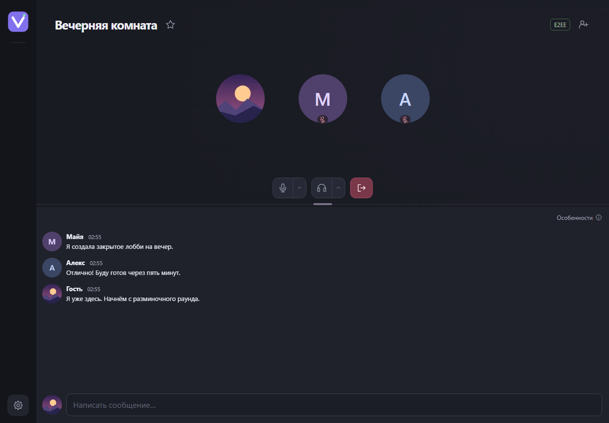
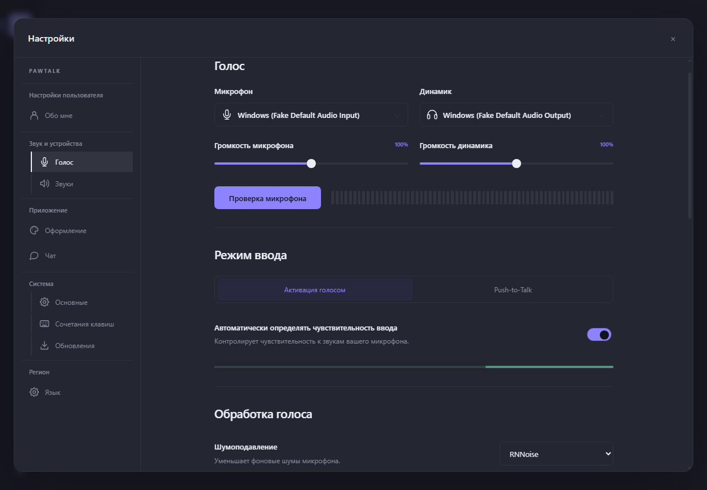
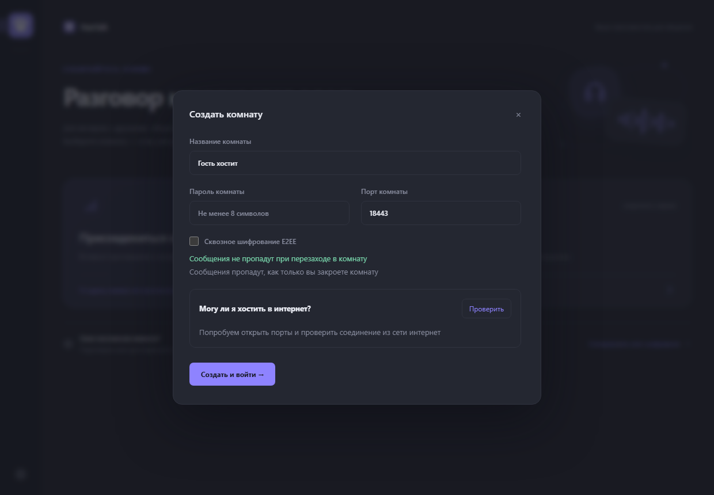

# PawTalk — голосовой чат для игр и друзей на своём сервере

Русский · [English](README.md)

[](https://github.com/IlyaRusskikh/PawTalk/actions/workflows/check.yml)

PawTalk — **альтернатива Discord и TeamSpeak для голосового общения** на Windows. Соберите друзей перед матчем, общайтесь с командой во время игры или заведите постоянную голосовую комнату для своего сообщества. Чтобы присоединиться, достаточно приглашения и никнейма. Регистрация не нужна.

**[Скачать PawTalk 0.7.1 для Windows 10/11 (x64)](https://github.com/IlyaRusskikh/pawtalk/releases/download/v0.7.1/PawTalk.Setup.0.7.1.exe)** · [Как начать](#как-начать) · [Сервер на Linux](docs/SERVER.md) · [Постоянный сервер на Windows](docs/SERVER-WINDOWS.md)



## Что можно делать в PawTalk

- **Собрать друзей на один вечер.** Создайте комнату на своём ПК и отправьте приглашение. Комната доступна, пока PawTalk работает, в том числе в трее.
- **Общаться по локальной сети.** Для LAN-вечеринки или игры в одной сети поделитесь локальным приглашением.
- **Открыть постоянную комнату для команды.** Разместите сервер на Linux VPS или на постоянно включённом Windows-ПК через Docker Swarm в Linux VM. Комната работает независимо от приложения PawTalk; при размещении на VPS друзья смогут общаться и при выключенном домашнем ПК. [Инструкция для Windows](docs/SERVER-WINDOWS.md).

## Сравнение возможностей

| Возможность                              | PawTalk | Discord | TeamSpeak |
| ---------------------------------------- | :-----: | :-----: | :-------: |
| Продвинутое шумоподавление               |   ✅    |   ✅    |    ❌     |
| Подавление голоса собеседника рядом      |   ✅    |   ❌    |    ❌     |
| Современный интерфейс                    |   ✅    |   ✅    |    ❌     |
| Размещение сервера на своём оборудовании |   ✅    |   ❌    |    ✅     |
| Открытый исходный код клиента и сервера  |   ✅    |   ❌    |    ❌     |

## Знакомое управление голосом, свой сервер

Из **Discord** мы взяли удобство голосовых комнат и настройку громкости каждого собеседника. Из **TeamSpeak** — возможность разместить сервер у себя и решать, кто получит доступ. В PawTalk эти идеи сочетаются с открытым исходным кодом и входом по приглашению.

- **Настройте звук под себя.** Выберите микрофон и наушники, проверьте, как звучит ваш голос, и отрегулируйте громкость участников по отдельности.
- **Говорите голосом или по кнопке.** Включите автоматическую активацию или Push-to-Talk. Используйте глобальные клавиши, чтобы управлять микрофоном и входящим звуком, пока открыта игра.
- **Управляйте звонком.** Кнопки над разделителем чата позволяют выключить звук, сменить аудиоустройства или выйти. При наведении на аватар появляются имя и значок связи. Наведите курсор на значок связи, чтобы увидеть текущий пинг. Нажмите на него, чтобы открыть сводку с потерями исходящих аудиопакетов до LiveKit-сервера по RTCP-отчётам принимающей стороны; клик снаружи закрывает поповер. В собственной карточке кнопка «Отладка» открывает вкладки «Передача данных» и «Исходящие» с графиками за две минуты. История остаётся на устройстве и сбрасывается при выходе из комнаты.
- **Поставьте аватар.** В разделе **«Настройки → Обо мне»** выберите PNG, JPEG или WebP, настройте масштаб и положение изображения в круглом предпросмотре. Участники увидят актуальный ник и аватар в комнате и в сохранённой переписке.
- **Сделайте речь разборчивее.** RNNoise снижает фоновый шум на вашем ПК, эхоподавление уменьшает эхо, а автоусиление выравнивает громкость вашей речи.
- **Возвращайтесь в любимые комнаты.** Добавьте сервер в закладки, чтобы быстро зайти снова. Текущая несохранённая голосовая комната появляется в сайдбаре со значком секундомера; наведите на него и нажмите звёздочку, чтобы сохранить комнату. Превью ответов сохраняют форматирование сообщений.
- **Пишите сообщения во время разговора.** Чат открывается под карточками участников. Нажмите Enter для отправки или Shift+Enter для новой строки. Можно отправлять до трёх сообщений в секунду и видеть, когда кто-то печатает. Перетаскивайте разделитель, чтобы менять высоту областей. Встроенные комнаты с E2EE держат историю в памяти до остановки сервера. История VPS хранится без срока давности в пределах заданного объёма (см. статус проекта).
- **Слушайте комнату.** Все записи уведомлений распространяются по CC0. Мяуканье отмечает вход и выход. Пять вариантов мягкого мурлыканья уведомляют о новых сообщениях в текущей комнате, когда приложение неактивно или чат прокручен выше. Свои сообщения и загруженная история не озвучиваются. Звуки используют выбранное устройство и громкость; отключить их можно в **Настройки → Звук и устройства → Звуки**.

<details>
<summary>Посмотреть настройки звука и создание комнаты</summary>





</details>

## Как начать

1. **Установите PawTalk.** [Скачайте установщик](https://github.com/IlyaRusskikh/pawtalk/releases/download/v0.7.1/PawTalk.Setup.0.7.1.exe) на каждый Windows-ПК. Выберите русский или английский язык.
2. **Представьтесь.** Откройте **Настройки → Обо мне** и укажите никнейм. В разделе **Голос** можно сразу проверить микрофон.
3. **Соберите друзей.** Нажмите **Создать комнату**, задайте название и пароль от 8 символов. Отправьте полное приглашение лично. Друг открывает **Присоединиться к комнате** и вставляет ссылку.

Если у вас уже есть приглашение, после установки сразу откройте **Присоединиться к комнате**. [Пошаговая инструкция для первого разговора на двух ПК](docs/FIRST-CALL.ru.md).

## Вопросы и настройка

<details>
<summary>Как пригласить друга?</summary>

В форме создания комнаты нажмите **Проверить** рядом с **Могу ли я хостить в интернет?**. Для доступа извне по умолчанию нужны входящие TCP 18443, TCP 18444 и UDP 18445. Если роутер или провайдер ограничивает входящие подключения, можно разместить комнату на Linux VPS с публичным IP. Для постоянного сервера на домашнем Windows-ПК используйте [Docker Swarm в Linux VM](docs/SERVER-WINDOWS.md); для доступа из интернета также нужны публичный IP и проброс портов.
Чтобы проверить возможность селфхостинга, скопируйте команду в **Windows PowerShell**:

```powershell
$code = (Invoke-WebRequest -UseBasicParsing 'https://raw.githubusercontent.com/IlyaRusskikh/pawtalk/main/scripts/check-selfhost.ps1').Content; & ([ScriptBlock]::Create($code))
```

[Как работает проверка](docs/SELFHOST-CHECK.md) · [Настройка Linux-сервера](docs/SERVER.md).

</details>

<details>
<summary>На каких устройствах работает PawTalk?</summary>

Клиент рассчитан на Windows 10/11 x64. Постоянный сервер можно развернуть через Docker Swarm на Linux amd64 или arm64, в том числе в [Linux VM на Windows-ПК](docs/SERVER-WINDOWS.md), который остаётся включённым. Голос передаётся через медиасервер LiveKit по WebRTC. [Руководство по серверу](docs/SERVER.md).

</details>

<details>
<summary>Безопасно ли пользоваться PawTalk?</summary>

PawTalk защищает соединение с сервером через TLS и проверяет отпечаток сертификата из приглашения. Голос защищён при передаче через WebRTC. Но **без E2EE владелец сервера может получить доступ к голосу и сохранённому чату**: выбирайте сервер, которому доверяете.

Для голоса и чата можно включить **экспериментальное сквозное шифрование (E2EE)**. Оно выключено по умолчанию; общий ключ передаётся участникам через приглашение. Сервер по-прежнему видит IP, список участников, время и объём трафика. Автоматической смены ключей и forward secrecy пока нет. Приглашение встроенной комнаты содержит пароль и, при включённом E2EE, секретный ключ: передавайте его лично и не публикуйте.

PawTalk пока находится в предварительном выпуске. Обновления проверяются по подписанному манифесту и SHA-256, но Windows-установщик ещё не подписан Authenticode. [Модель защиты и настройка E2EE](docs/E2EE.md) · [Политика безопасности и сообщения об уязвимостях](SECURITY.md).

</details>

<details>
<summary>Как обновиться или получить помощь?</summary>

В актуальных версиях PawTalk проверяет релизы GitHub при запуске и перед установкой проверяет подпись манифеста и SHA-256 файла. Если GitHub недоступен, загрузка может выполняться через совместимую комнату из закладок. Это поддерживают и встроенные self-host комнаты Windows, и комнаты на VPS; комната должна работать и иметь доступ к GitHub для метаданных и отсутствующих в кэше файлов. Сервер передаёт установщик потоком и хранит один установщик на диске: повторные загрузки обходятся без скачивания EXE с GitHub, а после полной загрузки новой версии старый файл автоматически удаляется. Сервер не ограничивает скорость передачи установщика.

[Подробнее об обновлениях](docs/UPDATES.md).
При проблемах с установкой или подключением начните с [руководства](docs/GUIDE.ru.md). Вопросы и предложения можно оставить в [GitHub Issues](https://github.com/IlyaRusskikh/pawtalk/issues/new/choose). Укажите версию и шаги воспроизведения. Удалите из сообщения действующие приглашения, пароли, ключи и личные сетевые данные.

</details>

## Для разработчиков

<details>
<summary>Сборка и проверки на Windows x64</summary>

Понадобятся Node.js **24.22.1+** с npm, Go **1.27.3+**, Python **3.13** и Visual Studio Build Tools с компонентом **Desktop development with C++** и Windows SDK. Путь к Go можно задать через `PAWTALK_GO`.

```powershell
npm ci
npm run native:build
npm run dev
```

Для сборки установщика запустите `.\build.cmd -InstallDependencies`. Первый запуск для разработки собирает встроенный API и загружает LiveKit с проверкой контрольной суммы. [Руководство по сборке](docs/GUIDE.ru.md).

При изменениях клиента запустите `npm run build`, `npm test`, `npm run smoke` и `npm run check:public`. Для сервера запустите `go test ./...` и `go vet ./...` в каталоге `server`. [GitHub Actions](https://github.com/IlyaRusskikh/pawtalk/actions/workflows/check.yml).

</details>

[Все инструкции](docs/README.md) · [Разработка и локальный Docker](docs/DEVELOPMENT.md) · [Архитектура](docs/ARCHITECTURE.md) · [Участие в разработке](CONTRIBUTING.md) · [API](docs/API.md) · [Порядок выпуска](docs/RELEASING.md)

Код PawTalk распространяется по лицензии [GNU AGPL-3.0-only](LICENSE). У сторонних компонентов свои условия. [Уведомления о лицензиях](THIRD_PARTY_NOTICES.md).

[Разбор каждого параметра серверного .env](docs/SERVER.md#разбор-env-что-и-как-заполнять): допустимые значения, объём истории, обновления Swarm и применение изменений.

## Статус проекта

**Актуальный предварительный выпуск: [PawTalk 0.7.1](https://github.com/IlyaRusskikh/PawTalk/releases/tag/v0.7.1)** — клиент для Windows 10/11 x64 и собственный сервер для Linux amd64/arm64, включая Linux VM на постоянно включённом Windows-ПК. Это ещё не стабильная версия.

### Что доступно в 0.7.1

- Голосовые комнаты по приглашению без регистрации, Push-to-Talk, индивидуальная громкость, шумоподавление RNNoise и выбор аудиоустройств.
- Чат с ответами, Markdown, редактированием и удалением своих сообщений на обновлённом сервере, индикатором набора, превью комнат и непрочитанными сообщениями; статические PNG/JPEG/WebP до 2 МиБ.
- Профили и аватары, избранные комнаты, светлая/тёмная темы с настройкой цветов, русский и английский языки.
- Звуки входа, выхода и сообщений, общая настройка громкости и прослушивание уведомлений.
- Необязательное экспериментальное E2EE для голоса и чата. Секретный ключ передаётся участникам через приглашение. [Модель безопасности](docs/E2EE.md).
- Временная комната в Windows-приложении или постоянный сервер через Docker Swarm на Linux, в том числе в [Linux VM на Windows](docs/SERVER-WINDOWS.md). Для постоянного чата по умолчанию выделяется 128 МиБ; старые данные вытесняются при заполнении. [Установка сервера](docs/SERVER.md).
- Обновления с подписанным манифестом, проверкой SHA-256 и резервной загрузкой через совместимые избранные комнаты. [Как работают обновления](docs/UPDATES.md).

### Известные ограничения

- Windows-установщик **не подписан Authenticode**. В релизе опубликована контрольная сумма SHA-256, но она не заменяет подпись издателя.
- Аппаратная приёмка реальных микрофонов, глобального PTT в играх и UAC, соединений между разными сетями, потерь пакетов и большой нагрузки пока не завершена. Часть автоматических тестов использует синтетические устройства. [План приёмки](docs/ACCEPTANCE.md) · [История проверок](docs/VERIFICATION.md).
- E2EE **выключено по умолчанию и экспериментально**. Без E2EE медиасервер может получать доступ к голосу, а сервер — читать сохранённый чат. В E2EE ещё нет автоматической смены ключей или forward secrecy. Полные приглашения передавайте лично. [Подробнее](docs/E2EE.md).
  История версий — в [CHANGELOG](CHANGELOG.md), подробная карта настроек — в [SETTINGS](docs/SETTINGS.md), сообщения об уязвимостях — по [политике безопасности](SECURITY.md).
