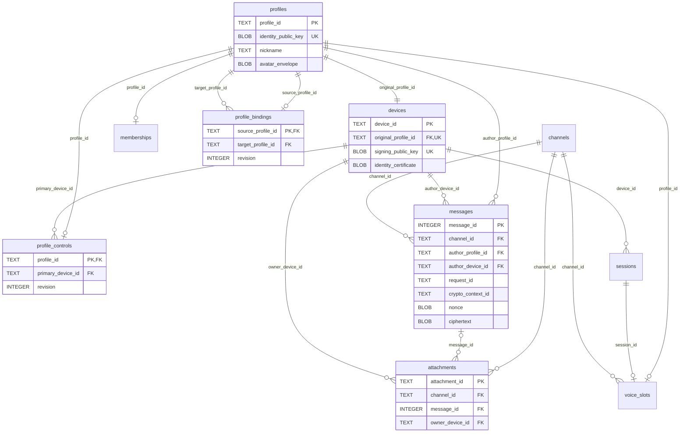

# Физическая БД API 2

Схема 2, SQLite STRICT. Полные столбцы, типы, FK, CHECK, индексы и триггеры:
[membership.sql](../server/membership.sql). Это DDL новой установки, не миграция
API 1. Постоянный сервер использует `membership-v2.sqlite`, selfhost — память.
Одна БД относится к одному серверу, поэтому server_id не дублируется во всех таблицах.

Ниже ключевые связи идентичности и контента; остальные FK перечислены в таблице
и полностью определены в DDL. Имена полей совпадают с реализацией.

## Полный перечень таблиц

| Таблица | Ключи и связи | Назначение |
| --- | --- | --- |
| server_state | id=1; UNIQUE server_id | Schema/version, подпись идентичности сервера, name/revision, публичный key ID E2EE |
| profiles | PK profile_id; UNIQUE identity_public_key | Неизменная исходная личность, серверные nickname/avatar/revision |
| devices | PK device_id; UNIQUE original_profile_id → profiles; UNIQUE signing_public_key | Одно устройство на исходную личность; сертификат устройства |
| memberships | PK profile_id → profiles | active/left/kicked/revoked, joined/ended/revision; членство отдельно от профиля |
| profile_bindings | PK source_profile_id → profiles; target_profile_id → profiles | Плоская текущая группа; триггеры запрещают цепочки/циклы |
| profile_controls | PK profile_id → profiles; primary_device_id → devices | Основное устройство и revision управления |
| roles | PK role_id | member/moderator/admin; фиксированные роли текущего scope |
| role_permissions | role_id → roles; составной PK | Отдельные операции роли, без канальных ACL |
| profile_roles | profile_id → profiles; role_id → roles | Собственные сохранённые роли исходной личности |
| group_roles | profile_id → profiles; role_id → roles | Текущие права объединённой группы, выбранные основным |
| group_profiles | PK profile_id → profiles; avatar_profile_id → profiles | Сохраняет внешний вид группы при rebase ID, без потери исходных профилей |
| sessions | PK session_id; device_id → devices | Проверочный хэш токена, срок и heartbeat; полномочия вычисляются при каждом запросе |
| auth_challenges | PK challenge_id | Одноразовый ограниченный challenge; не создаёт членство |
| device_link_requests | PK request_id; target/source/chosen → profiles; main devices → devices | Временный подписанный обмен, revisions, код подтверждения, opaque package |
| ban_actions | PK ban_id; issued_by_profile_id → profiles | Причина, срок и снятие бана |
| ban_subjects | ban_id → ban_actions; profile_id → profiles | Снимок исходных личностей; отвязка не снимает бан |
| channels | PK channel_id; created_by_profile_id → profiles | text/voice, protected_kind, порядок и revisions |
| messages | PK message_id; channel_id → channels; composite (author_device_id,author_profile_id) → devices | Неизменные автор/канал/request/key context; UNIQUE (author_device_id,request_id) |
| attachments | PK attachment_id; channel_id → channels; nullable message_id → messages; owner_device_id → devices | Зашифрованная загрузка до сообщения; staging TTL, квоты и атомарная привязка |
| invites | PK invite_id; created_by_profile_id → profiles | single/reusable/bootstrap, token hash, TTL/state, encrypted package |
| invite_attempts | PK attempt_id; invite_id/kind → invites; device_id/profile_id → devices | reserved/confirmed/expired/cancelled; UNIQUE invite/device и device/request |
| invite_redemptions | PK attempt_id → invite_attempts; profile_id → profiles | Идемпотентное подтверждение вступления |
| voice_slots | PK profile_id → profiles; UNIQUE session_id → sessions; channel_id → channels | Один голосовой слот группы с lease |
| audit_events | PK event_id; actor_profile_id → profiles | Ограниченный журнал действий без секретов |
| mutation_receipts | device_id → devices; составной PK | Идемпотентность изменения с областью устройства и операции |

`effective_profiles` и `effective_profile_roles` — views, применяющие overrides
группы к исходным данным. Автор сообщения остаётся исходной личностью; клиент
разрешает её через текущие bindings. Удаление одной связи сразу восстанавливает
самостоятельное отображение и собственные права устройства, без переписывания истории.

Передача управления меняет main device, сохраняя ID группы. При отвязке владельца
текущего ID группа получает исходный ID нового основного; group_profiles/group_roles
сохраняют её внешний вид и права. Старые группы автоматически не восстанавливаются.

Удаление обычного канала каскадно удаляет сообщения/вложения. Защищённые каналы
нельзя удалить на уровне БД. Авторство неизменно; редактирование обновляет ciphertext
и nonce. Nullable message_id нужен именно для staging, до существования сообщения.

Сервер хранит собственный signing seed и media credentials хоста. Клиентские
закрытые ключи, root E2EE и ключи открытия приглашений сюда не поступают.
Подробности транзакций/криптоконтекстов: [API-V2.md](API-V2.md).
