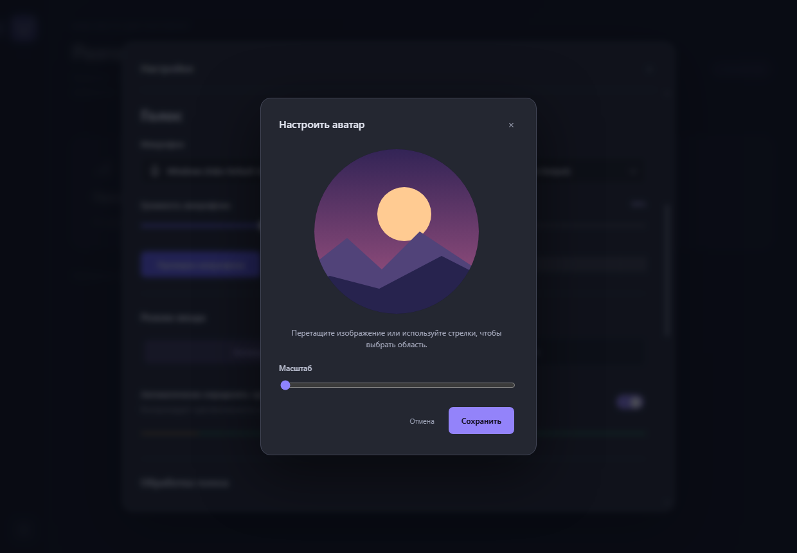

# PawTalk

Частная голосовая комната с текстовым чатом для Windows 10/11. Вход по приглашению или адресу сервера, общему паролю и никнейму. Аккаунт не нужен.

**Стек:** Electron 45 / React 19 / TypeScript 7 / LiveKit JS 2.23; Go 1.27; LiveKit Server 1.13.11. Готовый серверный образ включает Go API и LiveKit, Caddy для актуальных сценариев не нужен. Точные JS-версии — в `package-lock.json`. [Актуальная документация](README.md).

## Что реализовано

- Тёмный интерфейс, подключение, список участников и индикация речи.
- Выбор устройств, уровни 0–200%, тест микрофона с прослушиванием и индикатором.
- Активация голосом: автоматический или ручной порог, гистерезис и удержание конца фразы.
- PTT с задержкой отпускания; native Windows keyboard/mouse hooks работают вне фокуса окна.
- WebRTC echo cancellation / noise suppression / AGC; обработка выполняется локально.
- Режимы шумоподавления «Выключено / Стандартное / Нейросетевое RNNoise», оценка речи и защита начала фразы. RNNoise поставляется вместе с приложением, работает локально и не требует подписки. Начните с него и автоматической чувствительности. Подробности и задержка: [docs/RNNOISE.md](RNNOISE.md).
- Mute/deafen, индивидуальная громкость и локальное отключение собеседника.
- Глобальные сочетания для mute/deafen, трей, звуки подключения, сохранение настроек.
- Приглушение других Windows-аудиосессий с восстановлением исходных уровней.
- Переподключение LiveKit при кратком обрыве, обработка устройств и сна, диагностика сети.
- Настройки голоса с сегментным индикатором проверки, ручным порогом прямо на шкале и компактным выбором шумоподавления. До включения проверки сегменты серые, во время проверки звук подсвечивается жёлтым.
- Закладки комнат: добавление после подключения, хранение пароля и ключа E2EE через Windows/Electron safeStorage. Удаление закладки удаляет сохранённые секреты; в localStorage остаются только название и адрес без секретного фрагмента.
- Показатели связи открываются наведением или фокусом на антенну/«На связи»: задержка в мс и потеря пакетов в процентах. Адрес сервера в подключённой боковой панели скрыт. Отдельной страницы диагностики нет.
- Go API с PBKDF2-проверкой пароля, лимитом попыток и токенами только для микрофона.
- Экспериментальное E2EE: чекбокс при создании комнаты и обязательный режим на VPS; ключ остаётся у клиентов. Выключено по умолчанию. Проверки, замеры CPU/задержки и ограничения: [docs/E2EE.md](E2EE.md).
- Docker Compose для VPS, `docker run` для локального тестового сервера, встроенная LAN-комната Windows, сборка установщика и CI.
- Встроенный сервер: создание временной комнаты прямо из клиента, автоматический проброс UPnP / NAT-PMP, приглашения с проверкой TLS-сертификата и сохранённые соединения.

Client 0.10.1 — предварительный выпуск. Server 0.10.1 и Manager 0.2.1 выпускаются независимо; опубликованный Client 0.10.1 использует ядро Go Server 0.8.0 с патчем безопасности, а сборки из текущих исходников — общее ядро `server/` ([совместимость](COMPATIBILITY.md)). Установка готового клиента и SHA-256: [первый разговор](FIRST-CALL.ru.md). Названия настроек: [справочник](SETTINGS.md). Для стабильного релиза нужны аппаратные испытания из [ACCEPTANCE.md](ACCEPTANCE.md). Сходство звучания с Discord пока не подтверждено измерениями.

## Комната из приложения

1. Установите клиент и нажмите **«Создать комнату»**.
2. Никнейм задаётся в **«Настройки → Обо мне»**. В форме создания укажите название комнаты, пароль от 8 символов и при необходимости измените порт (по умолчанию 18443).
3. Приложение запустит API и LiveKit и попробует открыть на роутере TCP 18443, TCP 18444 и UDP 18445. При изменении базового порта меняются и следующие два. TCP 18446 используется только локально для LiveKit.
4. Откройте окно приглашения, выберите локальный или глобальный адрес и скопируйте полную ссылку `pawtalk://IP:порт/отпечаток#password=…&name=…`. Пароль уже включён в ссылку; при E2EE она также содержит ключ шифрования. Передавайте её только участникам комнаты по личному каналу. Друг вставляет приглашение в форму подключения. Устанавливать сертификаты вручную не нужно: приложение сверяет SHA-256 сертификата с приглашением перед отправкой пароля.

Пользователю не нужны Go, Docker, Node.js или VPS: серверные программы входят в установщик. Если Windows запросит доступ к сети, разрешите его для PawTalk и LiveKit. Приложение не отключает брандмауэр и не изменяет профиль сети.

Комната остаётся доступна в трее; **«Закрыть комнату для всех»**, полный выход из приложения или сон компьютера закрывают её. При штатном закрытии пробросы удаляются. Используются временные аренды, которые приложение продлевает; после аварии аренды перестают продлеваться (запрошенный срок — 20 минут). Постоянный проброс для роутеров, которые поддерживают только бессрочные правила, не создаётся.

Подтверждение проброса роутером не означает проверенную доступность из интернета. При CGNAT, двойном NAT, сетевых ограничениях или запрете автопроброса используйте приглашение для локальной сети либо отдельный VPS. Hole punching, STUN для поиска адреса хоста и ретранслятор в этот режим не добавлены. Встроенный WebRTC-транспорт LiveKit сохраняется.

После подключения можно добавить комнату в закладки кнопкой рядом с её названием. Пароль и ключ E2EE сохраняются в защищённом хранилище, адрес без секретного фрагмента и название появляются на боковой панели. Контекстное меню позволяет удалить закладку вместе с сохранёнными секретами. После перезапуска встроенного сервера гостям нужно новое приглашение с отпечатком нового сертификата. История встроенной комнаты очищается при остановке сервера. Для постоянного адреса используйте отдельный сервер на VPS.

### Чат и профиль

Чат открыт под участниками. Перетащите разделитель, чтобы изменить высоту панелей.
Enter отправляет сообщение, Shift+Enter добавляет новую строку. Индикатор над полем
показывает, кто печатает. При наличии непрочитанных сообщений кнопка «Перейти к новым»
прокручивает к первому из них.

Встроенная комната держит историю в памяти до остановки хоста при включённом E2EE;
без E2EE переписка может очищаться при выходе. Постоянный сервер на VPS хранит
чат в SQLite с лимитом `PAWTALK_CHAT_MAX_MB` (128 МиБ по умолчанию,
`0` — без ограничения объёма). При заполнении удаляется старейшая история,
включая вложения, и освобождается место в SQLite. При включённом E2EE и
настроенном идентификаторе ключа содержимое чата зашифровано клиентом.
Без E2EE сервер может читать сохранённую переписку.

В **Настройки → Обо мне** выберите PNG, JPEG или WebP. Перетащите изображение
и настройте масштаб в круглом предпросмотре. Сохранённый аватар появится в комнате
и рядом с сообщениями.



## Клиент: разработка

Встроенная комната выпускает временный сертификат с IP SAN для адресов приглашения (LAN, публичный IP при пробросе, loopback). Проверка SHA-256 из приглашения обязательна; устанавливать отдельный корневой сертификат не нужно. После пересоздания комнаты передайте участникам новое приглашение.

При входе по адресу без встроенного пароля приложение сначала проверяет соединение и затем запрашивает пароль. Для отдельной диагностики приглашения используйте скрипты из следующего абзаца либо кнопку «Скопировать скрипт проверки» в окне приглашения. Диагностика проверяет TLS, сертификат, `/healthz` и доступность `/rtc` без пароля; ошибки различают тайм-аут, отказ TCP, сбой TLS и устаревший сертификат. Успех из текущей сети не доказывает работоспособность WebRTC/UDP либо доступность из другой сети. Своё текущее приглашение на компьютере хоста автоматически направляется на loopback с сохранением проверки сертификата; чужие и старые приглашения не подменяются.

Без установки клиента можно передать другу `scripts/diagnose-invitation.cmd` и `scripts/diagnose-invitation.ps1` в одной папке. Запуск CMD просит текущее приглашение и создаёт `connection-report.json` с этапом сбоя: TCP, TLS, сертификат или HTTP health. Пароль не запрашивается и не отправляется. Node.js и права администратора не нужны. Альтернатива для разработчика: `node scripts/diagnose-room.cjs "pawtalk://…"` проверяет TCP/TLS/сертификат.

Разрешение Windows и UPnP/NAT-PMP — разные этапы: первое разрешает входящие пакеты программе, второе направляет их с роутера на ПК. Успешный ответ роутера не является проверкой из интернета. Даже с пробросом возможны блокировки, CGNAT/двойной NAT и обратный маршрут через VPN. Не отключайте брандмауэр целиком; проверяйте конкретную программу/порт и фактический маршрут. Для одной локальной сети используйте приглашение «Локальная сеть».

При локальном прослушивании микрофона браузерное эхоподавление временно отключается: опорным звуком иначе становится собственная речь. После остановки восстанавливается настройка пользователя. Прослушивание подключено прямо к выходу AudioWorklet без HTML-плеера. При смене браузерной обработки захват переоткрывается с новыми параметрами, потому что Chromium может принять `applyConstraints`, но сохранить старое значение AEC; опубликованная дорожка и AudioWorklet при этом сохраняются. Для проверки используйте наушники.

Для воспроизводимого анализа обрывов: `node scripts/check-speech.mjs C:/path/voice.wav [output-directory]`. Нужен исходный WAV PCM16, моно, 48 кГц, записанный без фильтров. Скрипт локально прогоняет его через реальный RNNoise, активацию голосом и автоусиление на трёх уровнях, сохраняет вход/выход и покадровые вероятности речи/порог/состояние передачи. Он не моделирует акустическую обратную связь или браузерный AEC. Доля энергии при закрытой передаче — диагностическая метрика, а не оценка разборчивости. Личные записи не нужно добавлять в репозиторий.

Приглашение `pawtalk://…` вставляется в форму «Присоединиться к комнате». Если пароль уже включён в ссылку, отдельно вводить его не нужно; для адреса сервера без пароля приложение открывает отдельный диалог. Это не веб-страница; поиск Google по приглашению не подключает к комнате. Установщик регистрирует протокол `pawtalk` в Windows, чтобы поддерживающие такие ссылки приложения могли открыть PawTalk с заполненным адресом. Открытие приглашения не подключает автоматически. Кнопка копирования в десктопной версии использует буфер обмена Electron.

Громкость участника и общая громкость применяются через WebAudio-микшер LiveKit; HTML-плеер при этом заглушён, поэтому обходного воспроизведения с исходной громкостью нет. Диапазон участника — 0–200%, локальное отключение и deafen применяются к тому же пути воспроизведения.

Автоусиление реализовано в локальном AudioWorklet после определения речи: целевой RMS 0,12, усиление ограничено диапазоном 0,25–8. Браузерное автоусиление отключено, чтобы два регулятора не конкурировали. Порог активации рассчитывается до усиления; выключение микрофона и нулевая ручная громкость остаются приоритетными.

Обычное браузерное эхоподавление включено по умолчанию. Дополнительный фильтр «Подавлять голос собеседника рядом» включается отдельно и по умолчанию выключен: он сравнивает микрофон с входящим голосом и добавляет 80 мс буферизации. При включении более тихая коррелирующая копия ослабляется до 2% до RNNoise и автоусиления; сравнение учитывает до 300 мс истории входящего звука. Без входящих дорожек буфер не включается. Сильная реверберация, несколько одновременно говорящих людей и поздний опорный сигнал могут снижать результат; проверяйте фильтр на реальных микрофонах.

Микрофон и воспроизведение одного сеанса используют общий AudioContext. В локальном сравнении с RNNoise и E2EE это сократило медианную программную задержку со 136 до 115 мс. Метод, расходы CPU и ограничения: [docs/LATENCY.md](LATENCY.md).

Понадобятся Node.js **24.22.1+**, npm, Python 3.13 и Visual Studio Build Tools 2022/2026 с компонентом **Desktop development with C++** и Windows SDK, а также Go **1.27.3+** для сборки встроенного API. Путь к Go можно указать через `PAWTALK_GO`.

```powershell
npm ci
npm run native:build
npm run dev
```

Без native-модуля интерфейс и активация голосом работают, но PTT и системное приглушение недоступны. Приложение явно сообщает об этом. `npm run dev:web` — только браузерный предпросмотр; подключение выполняется через защищённый Electron IPC.

`npm run server:prepare` собирает встроенный API из текущего общего `server/`, как и постоянный Windows Server, и загружает официальный Windows x64 LiveKit 1.13.11 с проверкой SHA-256 архива по опубликованному checksums.txt. Шаг выполняется автоматически при `dev`, `package`, `package:dir` и сборке через `build.cmd`. Для первой подготовки нужен интернет и штатный Windows `tar.exe`; дальнейшие запуски используют загруженный LiveKit.

Обновления звуковых настроек применяются автоматически. До включения проверки микрофона сегменты шкалы серые; во время проверки уровень подсвечивается жёлтым. Отметка отображает ручной или автоматический порог. Кнопка «Проверка микрофона» включает прослушивание, «Прекратить проверку» останавливает его. Смена устройств и обработки не выключает прослушивание; фильтры применяются к текущему захвату, при смене микрофона меняется только источник. При выходе из настроек локальный захват прекращается. Во время разговора шкала использует уже работающий микрофон комнаты. Надевайте наушники при прослушивании.

Сочетания задаются в формате Electron, например `Control+Shift+M`. Недоступные комбинации отображаются в настройках. PTT использует одну выбранную клавишу или боковую кнопку мыши; клавиши не блокируются для других приложений. Работа поверх игр с повышенными правами и античитом требует отдельной проверки.

## Постоянный сервер на VPS: Docker Compose

Для установки на Linux VPS поддерживается только Docker Compose: один сервис
комнаты, одна реплика и постоянный Docker volume на одном хосте.
Нужны Debian 12 / Ubuntu 24.04, Docker Engine/Compose, Python 3.11+, OpenSSL 3 и публичный IP. Используется готовый образ GHCR;
Node.js, Go и домен на VPS не нужны.

Следуйте [пошаговой инструкции](SERVER.md): проверенный установщик, интерактивная
конфигурация и автоматическое создание нового volume/Compose-комнаты.
Откройте TCP 18443, TCP 18444 и UDP 18445. Подключайтесь полным приглашением
`pawtalk://…` и паролем. Независимые обновления, backup и восстановление новой комнаты:
[SERVER.md](SERVER.md).

## Локальная сеть на двух Windows-ПК

Для актуального PawTalk **не требуется Docker, Caddy или отдельный CA-сертификат**:
создайте комнату прямо в клиенте Windows (кнопка «Создать комнату») и в окне
приглашения выберите локальный IP-адрес. Передайте другу полное приглашение
`pawtalk://…` по личному каналу — оно содержит отпечаток TLS-сертификата.
Друг устанавливает клиент и вставляет приглашение в «Присоединиться к комнате».
Никаких дополнительных корневых сертификатов устанавливать не нужно.

Проверьте, что оба компьютера находятся в одной сети, отключена изоляция
гостевых Wi-Fi-клиентов и Windows Firewall разрешает соединения приложению на
TCP `18443`, TCP `18444` и UDP `18445` (либо выбранный порт и его смещения
`+1` и `+2`). Не отключайте брандмауэр целиком. После закрытия комнаты или
перезапуска встроенного хоста приглашение нужно пересоздать.

Пошаговая инструкция для двух физических ПК: [FIRST-CALL.ru.md](FIRST-CALL.ru.md).
Для постоянно работающей комнаты даже без включённого компьютера владельца
используйте Linux VPS через Docker Compose: [SERVER.md](SERVER.md).

## Локальная разработка сервера без Compose

Для разработки можно запустить готовый объединённый Go/LiveKit образ
в Docker на `127.0.0.1`. Это **не** способ развёртывания VPS.

```powershell
npm run dev:server
```

В другом терминале запустите клиент:

```powershell
npm ci
npm run native:build
npm run dev
```

В логе первого запуска локального контейнера появляется пароль. Получить
актуальный `pawtalk://`-инвайт можно через:

```powershell
docker exec pawtalk-dev-server /pawtalk serve info
```

Для изменений исходников Go используйте `npm run dev:server -- --build`.
Серверные тесты и полный список команд — в [DEVELOPMENT.md](DEVELOPMENT.md).
Docker Compose plugin и генерация старой конфигурации Caddy не требуются.

## Проверки и сборка

### Установщик одной командой

В PowerShell перейдите в папку проекта и выполните:

```powershell
cd C:\projects\pawtalk
.\build.cmd
```

Если установлен GNU Make, тот же процесс запускается через Makefile:

```powershell
make installer
```

Просто `make` тоже собирает установщик. `build.cmd` запускает тот же `build.ps1` с разрешением выполнения только для текущего процесса: менять политику PowerShell не нужно. Node.js и npm находятся через PATH, стандартные пути установки и уже подготовленные инструменты текущего ПК. Сборка устанавливает зависимости, если их ещё нет, заново компилирует нативный модуль, проверяет его загрузку, собирает интерфейс и RNNoise, запускает тесты и создаёт Windows x64 NSIS-установщик. Ошибка любого шага останавливает сборку. Docker и запущенный сервер для этого не нужны.

Результат: `release/PawTalk Setup <версия>.exe`, для текущей версии — `release/PawTalk Setup 0.11.0.exe`. Друзьям передавайте этот файл. Версия берётся из `package.json`; повторная локальная сборка той же версии заменяет локальный установщик. Опубликованные теги и бинарники не заменяются. Для готовящегося Client 0.11.0 имя публикуемого файла — `PawTalk.Setup.0.11.0.exe` (с точками); локальная сборка ничего не публикует. Перед сборкой закройте запущенный `release/win-unpacked/PawTalk.exe`, если открывали его для проверки.

На новом компьютере нужны Node.js x64 с npm и инструменты C++ из раздела «Клиент: разработка». На текущем компьютере скрипт автоматически использует уже подготовленный portable LLVM. Чтобы принудительно использовать MSVC: `.\build.cmd -NativeToolchain msvc`. Для другого LLVM передайте `-NativeToolchain llvm -CompilerRoot <путь> -NodeHeaders <путь> -NodeImportLibrary <путь>`; также поддерживаются переменные `PAWTALK_LLVM_ROOT`, `PAWTALK_NODE_HEADERS`, `PAWTALK_NODE_LIB`.

После изменения `package-lock.json` выполните `.\build.cmd -InstallDependencies`: этот параметр запускает `npm ci` перед сборкой. При необходимости PowerShell-скрипт можно вызвать напрямую: `powershell.exe -NoProfile -ExecutionPolicy Bypass -File .\build.ps1`; политика системы при этом не меняется.

### Отдельные проверки

```powershell
npm run build
npm test
npm run smoke
cd server
go test ./...
go vet ./...
cd ..
npm run native:build
npm run package
```

`npm test` проверяет адреса, голосовой gate и скомпилированный AudioWorklet; перед ним нужен build. Smoke запускает настоящий Electron с синтетическим микрофоном, проверяет навигацию, аудиотракт, индикатор и остановку теста. Скриншоты записываются в `release/qa/`.

`npm run test:docker` запускает через `docker run` два изолированных контейнера Go API и LiveKit, повторяет аудиопроверку двух клиентов и вход через настоящий Electron IPC. Нужны работающий Linux Docker Engine, свободные порты 8080/7880/7881/7882/5173 и установленный node_modules; native-модуль и dist должны быть собраны. Тест сам генерирует временные ключи, не изменяет пользовательские конфигурации, затем удаляет свои контейнеры и сеть. Отчёт: `release/qa/docker.txt`.

После упаковки `node scripts/packaged-smoke.mjs` проверяет настоящий `release/win-unpacked/PawTalk.exe`, загрузку native-модуля, интерфейс и обязательный HTTPS. Для этой проверки используется отдельный временный профиль и локальный диагностический порт 19337; тестовый процесс завершается автоматически.

Установщик появится в `release/`. Сборка требует готового `native/build/Release/pawtalk.node`; этот модуль упаковывается отдельно от ASAR. Node-API позволяет использовать один модуль в Node.js и Electron без привязки к V8 ABI. Установщик без цифровой подписи может отображать предупреждение Windows; Authenticode-подпись не настроена; автообновление проверяет Ed25519-подпись манифеста и SHA-256 установщика.

CI `.github/workflows/check.yml` проверяет Go, Docker-образ, Windows native build, клиент и установщик. Он не заменяет испытания с реальными устройствами.

Дополнительные проверки: `node scripts/native-smoke.cjs` загружает Windows-модуль, регистрирует и снимает глобальные hooks без эмуляции пользовательских нажатий. При работающих Go API, LiveKit и Vite на loopback можно выполнить `electron scripts/integration.cjs`, передав общий пароль через `PAWTALK_TEST_PASSWORD`. Скрипт создаёт два изолированных клиента с синтетическими микрофонами и проверяет реальную передачу аудио через SFU, mute/PTT, громкость и ограничения токенов. `electron scripts/main-smoke.cjs` проверяет настоящий preload/IPC и вход в API с тем же паролем.

Альтернатива MSVC: `scripts/native-build-llvm.ps1` принимает пути к portable llvm-mingw, Node headers и Windows `node.lib`. Эта сборка использует статическую стандартную библиотеку и delay-load hook для совместимости с Electron. В репозитории нет скачанных компиляторов.

## Ограничения и диагностика

- Цель: до 30 соединений, обычный разговор до 10 человек. Нагрузочный результат пока не подтверждён.
- «Задержка» в попапе — сетевой RTT WebRTC, не полная задержка голоса. «Потеря пакетов» — взвешенный процент входящих RTP-пакетов за последний интервал измерения (обычно пять секунд); до первой выборки показывается «—». CPU/RAM измеряйте средствами ОС во время аппаратных испытаний.
- После окончательного разрыва или сна требуется повторный вход. Закладка использует пароль из защищённого хранилища; без закладки используйте действующее приглашение или введите пароль заново.
- Индивидуальные уровни действуют до отключения: постоянных идентификаторов пользователей нет.
- Приглушение восстанавливается при отключении, закрытии и остановке аудиопетли; native watchdog снимает его через две секунды без обновления. Принудительное убийство всего процесса/сбой ОС может помешать восстановлению: проверьте Windows Volume Mixer. Отдельного внешнего crash-guardian в этой версии нет.
- Не запускайте несколько экземпляров клиента с общими настройками. Обычный запуск ограничен одним экземпляром; испытания двух клиентов выполняются на двух компьютерах.

Описание API: [docs/API.md](API.md). Аппаратная приёмка: [docs/ACCEPTANCE.md](ACCEPTANCE.md).

## Чат и настройки актуальной версии

В меню своего сообщения доступны «Редактировать» и «Удалить сообщение», если сервер поддерживает изменения сообщений. Enter сохраняет правку, Shift+Enter переносит строку, Esc отменяет. Перед удалением показано превью; Shift при выборе удаления пропускает подтверждение. Изменения синхронизируются у участников. Выделение текста в поле ввода открывает панель форматирования. Поддерживаются Markdown, спойлеры, код, цитаты и ссылки; веб-ссылки открываются в браузере.

«Звук и устройства» объединяет «Голос» и «Звуки»; расширенная обработка и приглушение других приложений свёрнуты под голосом. В «Звуках» доступны общая громкость уведомлений и кнопки прослушивания. «Система» объединяет автозапуск, горячие клавиши и обновления. Язык — отдельная страница. Карта и границы сброса: [SETTINGS.md](SETTINGS.md).
